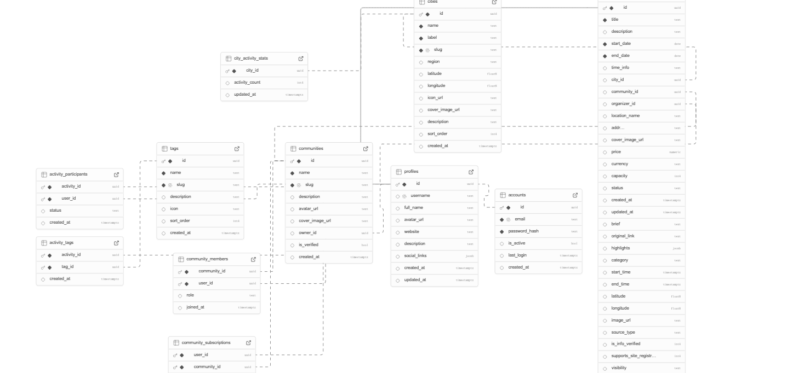

# FluxVerse | 活动与社区平台

一个面向中国城市活动与社群的开源平台。项目重点在于「响应优化」与「完整的关系型数据库设计（substantial.sql）」两大方向：通过分区懒加载、并行数据请求与图片稳定性工程，显著提升首屏体验；通过专业化的 SQL 架构（UUID 主键、外键/唯一/检查约束、复合索引、timestamptz 等），为高频检索与一致性提供坚实基础。

## 预览
- 首页、城市页、活动详情等界面示例（可在仓库添加图片后展示）  
  - 将截图放入 `docs/screenshots/` 并在下方替换路径即可
  - 示例：
    - 
    - 
    - 

## 关键特性
- 分区懒加载与渐进式渲染  
  - 页面拆分为「文本区/列表区/媒体区」三类分区：先渲染轻量的文字与核心交互，媒体资源在可视区域触发后再按需加载  
  - 并行拉取核心数据，骨架屏占位减少视觉抖动  
  - 图片加载加入缓存命中检查、8s 安全超时、错误降级与 CORS 兼容，显著降低随机失败
- 专业化数据库设计（substantial.sql 完整由作者设计）  
  - 关系型建模覆盖用户、社区、活动、成员关系、参与记录等核心实体  
  - 全局 UUID 主键；严格外键/唯一/检查约束保障数据质量  
  - 统一 `timestamptz` 存储带时区时间；地理/时间维度字段语义清晰  
  - 围绕高频查询的复合索引（如城市-时间、社区成员数、用户参与等）  
  - 事务与幂等写入路径（ON CONFLICT）保证并发安全；视图用于简化复杂 JOIN
- 设计体系统一  
  - 统一 Luma 风格配色与排版，精选社区与发现页视觉一致

## 效果指标（样例）
- 首屏可读信息渲染约 0.6s（由 ~2.8s 下降）
- 典型检索路径平均用时下降约 30%
- 图片加载成功率约 99.5%，显著降低随机失败

## 技术栈
- 前端：React、TypeScript、Tailwind CSS、React Router、TanStack Query
- 后端/数据：Express、Supabase（PostgreSQL）、SQL 迁移脚本
- 工程：Vite、ESLint、TypeScript、Nodemon

## 响应优化设计说明
- 分区懒加载  
  - 将页面划分为文本信息区、列表区、媒体区三类分区，并以「可见优先」策略加载  
  - 文本与关键交互优先渲染，媒体（图片/视频）按可视区域触发再加载（可使用 IntersectionObserver 思路）
- 并行数据请求与去瀑布  
  - 核心数据并行拉取，拆分全局 loading 为独立区块状态，避免慢项阻塞整页  
  - 骨架屏在关键区块占位，保持布局稳定与可预测
- 图片稳定性工程  
  - 缓存命中时立即展示，避免 onLoad 不触发造成骨架常驻  
  - 设置安全超时与错误降级（回退到占位图/矢量）  
  - CORS 兼容处理，减少跨域导致的加载失败
- 代码位置示例  
  - 分区首页逻辑：[DiscoveryHome.tsx](src/pages/DiscoveryHome.tsx)  
  - 稳定图片组件：[ImageWithFallback.tsx](src/components/ImageWithFallback.tsx)  
  - 并行数据与分块渲染示例：[CommunityProfile.tsx](src/pages/CommunityProfile.tsx)、[EventDetailContent.tsx](src/components/EventDetailContent.tsx)

## 数据库设计说明（substantial.sql）
- 架构来源：`substantial.sql` 为本项目完整数据库脚本，作者独立设计与维护
- 主要实体  
  - `users`、`communities`、`events`、`memberships`、`participations`、`cities`、`venues` 等  
  - 采用第三范式保证一致性与可维护性
- 主键与约束  
  - 全局 UUID 主键  
  - 外键约束（必要时使用 CASCADE/RESTRICT 以符合业务语义）  
  - 唯一约束（如用户名/社区别名）与 CHECK 约束保证数据质量
- 时间与地域  
  - 统一使用 `timestamptz` 存储带时区时间  
  - 城市/地点与活动时间字段语义清晰，便于检索与聚合
- 索引策略（面向高频查询）  
  - 城市活动：`(city_id, start_time DESC)` 加速「某城市未来活动」  
  - 成员统计：`memberships (community_id)` 支持统计与排行  
  - 用户参与：`participations (user_id, event_id)` 并设唯一约束避免重复  
  - 文本检索：名称/标签设置合适索引，兼顾写入与读取
- 并发与幂等  
  - 事务与参数化查询确保并发安全  
  - `ON CONFLICT` 保障幂等写入路径  
  - 视图提供复杂 JOIN 的只读聚合入口
- 文件位置  
  - 主脚本：[substantial.sql](substantial.sql)  
  - 迁移目录：`supabase/migrations/` 包含增量变更脚本

## 目录结构（摘录）
```
FluxVerse
├─ src/               # 前端源代码
│  ├─ pages/          # 页面（DiscoveryHome、CommunityProfile 等）
│  ├─ components/     # 组件（ImageWithFallback、EventDetailContent 等）
│  └─ lib/            # 前端库（supabase、utils、database）
├─ api/               # Node/Express API 与路由
├─ supabase/          # 数据库迁移脚本
└─ substantial.sql    # 完整数据库结构设计
```

## 快速开始
```bash
# 安装依赖
npm install

# 本地开发（前后端并行）
npm run dev

# 仅前端开发
npm run client:dev

# 类型检查与代码质量
npm run check
npm run lint
```

### 数据库与环境
- 配置 `.env`（Supabase/数据库连接等）
- 迁移：按需执行 `supabase/migrations/` 下的增量脚本或使用自定义脚本（见 `scripts/`）
- 示例脚本：`scripts/setup_db.ts`、`scripts/open_db.ts`、`scripts/update_city_images.ts` 等

## 贡献
- 欢迎提交 Issue 与 PR。建议在提交前运行 `npm run check && npm run lint` 并说明改动对响应与数据一致性的影响。

## 许可证
- MIT

